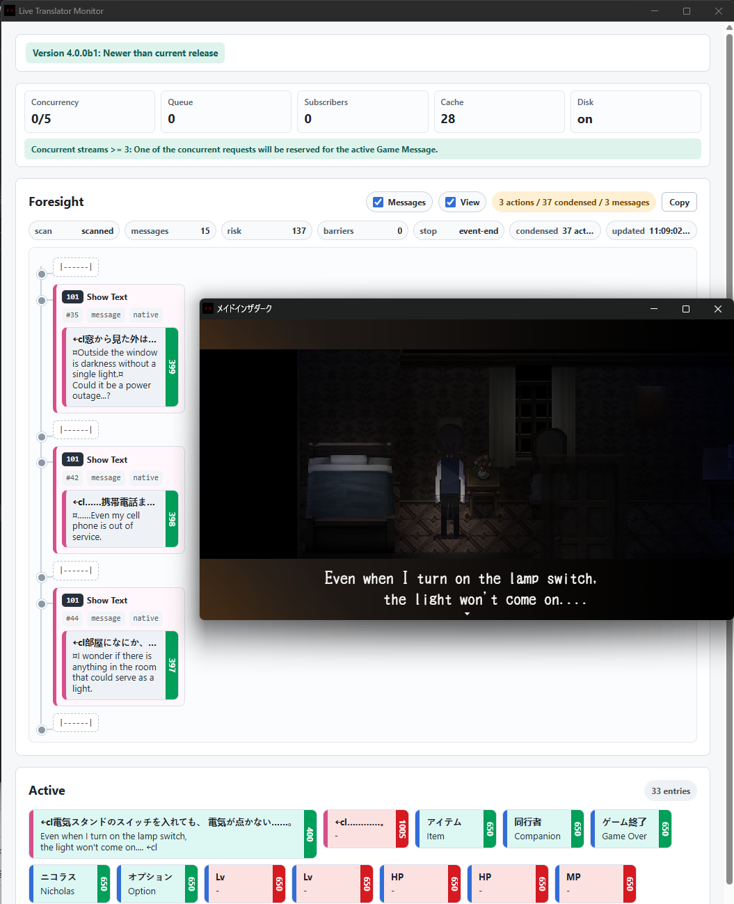
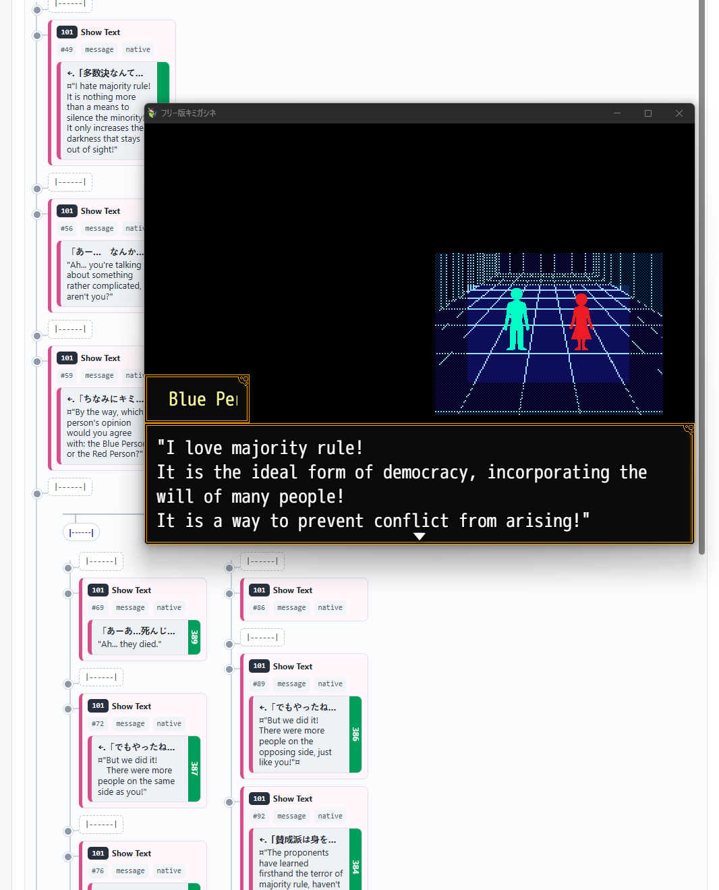

## Overview

RPG Maker MV / MZ Live Translator - Simply translates the text on the game screen (does its best).

Supports most games. Since RPG Maker is a scriptable platform, no implementation of a translator will work against every game. Chances are that some games will have subtle issues or won't work at all.

One thing it will never do is break the game silently, which is a recurring problem with file based machine translations.

A decent graphics card or an Apple Silicon mac required to run the LLM translation yourself (so that it's free).

  
  

## How it works, simplified

| Game                   | Translator                                                |
| ---------------------- | --------------------------------------------------------- |
| I'm going to draw text | Saves the background                                      |
| I've drawn the text    | Takes note                                                |
| ??                     | Translation arrived - draw background and the translation |
| GC'd                   | Forgets                                                   |

Foresight: Tries to peek ahead of the dialogue and finds texts to pre-translate.

## Web Installer (Recommended)

https://rmlt.pages.dev

Simply visit with a Chromium browser and point the game folder (where there's Game.exe).

## Prerequisites

1. If there's no `scripts/` in your game folder, it's probably been hidden inside `.exe` with Enigma Virtual Box. Unpack first.

2. Update the game's included nw.js library. All RPGMV/MZ games ship with nwjs installations - sometimes with very outdated ones that will not work with this addon. https://nwjs.io/downloads/ - Extract all files to the game directory (where Game.exe is) and change the name of nwjs.exe to Game.exe.

## Alternative Installations

Out of service. Go ask Codex or Claude to make one.

## Translators

llamafile

- 0-click LLM download and execution

- artifacts will be kept in .rmlt/

llama.cpp

- for advanced users
  . Batching is required (3+ recommended)

LM Studio (deprecated)

## Translator GUI

The translator monitor opens automatically when the game starts. If you close it, press `Ctrl+Shift+Enter` in the game window.

## Changelog

1.0 - major refactor - performance and accuracy improvements, etc

1.1 - fix DeepL 429, fix installer messing up `plugins.json` encoding

1.7 - move to Gemma 4 and fix game dependent crashes

1.8 - fix bitmap redraw clearing out graphics

1.10 - fix longstanding errorneous bitmap clear problems

1.11 - fix non-CJK games (English) and add an option to resize game_message

1.12 - Game_Message rewrite. Should handle multiline texts correctly and just be more robust in general.

1.13 - LLM auto works if there's one and only model loaded in LM Studio

1.14 - translation provider: none disables the translation and relies on translation-cache.log

2.0 - finally fixed the longstanding overlapping text problem

2.1 - fix text styling update not applying correctly on redrawn texts

2.2 - max token count per request is configurable

2.3 - major cosmetic fixes. original texts are replaced cleanly. fixed ghost text problem in selectable lists

3.0 - Add precacher

3.0.3 - harden GameMessage and invalid battlelog bitmaps detection/handling

3.1 - bitmap text handling major breaking change

3.2 - new: sprite-text-hook - replaces most of the bitmap text handling. new GUI for diagnosis/status. add options: textScaleOthers, originAwareLineBreaks

3.2.6 - text async redraw background clear correctness

3.2.7 - performance improvement (handles slow revealing sprite text better)

3.2.8 - errorneous translation abort hotfix

4.0 - Almost a complete rewrite: foresight support. compatibility improvements, batching, priority, performance optimizations, and more

5.0 - Rewrite. New low level architecture.

5.1 - reimplement foresight / performance improvements

---

RPG Maker MZ: ©Gotcha Gotcha Games Inc./YOJI OJIMA 2020.

RPG Maker MV: ©Gotcha Gotcha Games Inc./YOJI OJIMA 2015.

RPG MAKER is a registered trademark or trademark owned by Gotcha Gotcha Games Inc.

This independent project is not affiliated with or endorsed by Gotcha Gotcha Games Inc.
